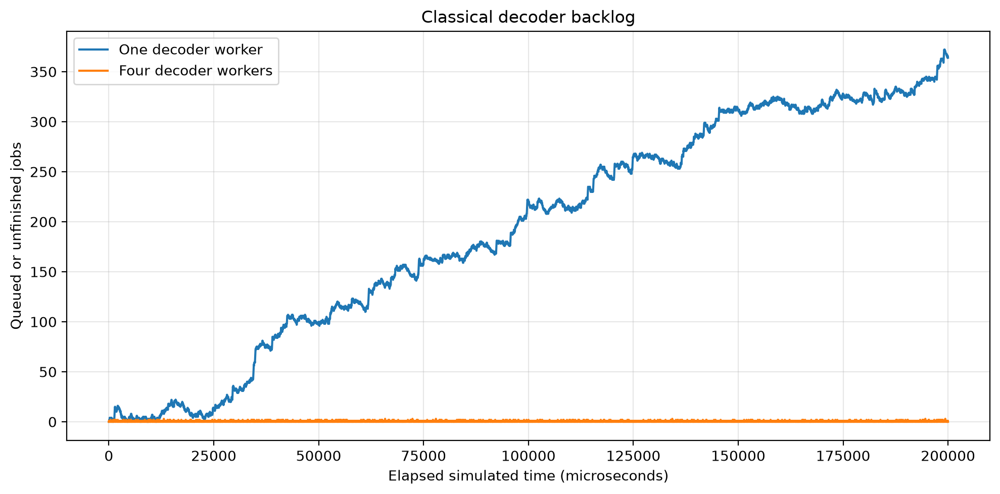
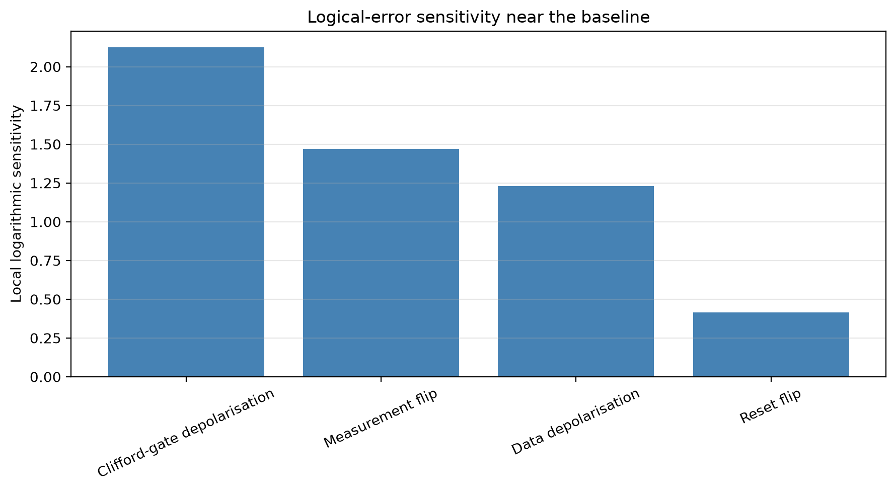

# Qiskit-Quantum-Analysis
# Circuit-Level Quantum Error Correction and Heterogeneous Classical Processing

This project investigates quantum error correction as a quantum-classical systems problem. It combines circuit-level simulation of repetition and rotated surface codes with minimum-weight perfect-matching decoding, statistical error analysis, classical decoder benchmarking, queue-based latency modelling, and GPU-accelerated detector-event preprocessing.

## Software stack

- **Qiskit 2.6.2** and **Qiskit Aer 0.18.4** for introductory circuits, statevectors and noise modelling
- **Stim 1.16.0** for high-performance stabilizer-circuit simulation and detector sampling
- **Sinter 1.16.0** for parallel and adaptive Monte Carlo collection
- **PyMatching 2.4.0** for minimum-weight perfect-matching decoding
- **NumPy**, **pandas** and **Matplotlib** for numerical analysis and visualisation
- **pytest 9.2.0** for automated verification
- **Python 3.14.6** on Windows 11

# Project Overview

## Part I: Quantum error correction and CPU analysis

### Quantum circuit and noise preparation

`quantum_noise_preparation.ipynb`

The introductory work establishes the concepts required for later error-correction experiments:

- computational-basis states;
- superposition and phase;
- finite-shot measurement statistics;
- Bell-state preparation and correlation;
- readout errors;
- single- and two-qubit depolarising noise.

These experiments provide ideal baselines before redundancy and error correction are introduced.

### Three-qubit repetition code

`repetition_code.ipynb`

A three-qubit bit-flip repetition code was implemented from first principles:

$$
|0_L\rangle = |000\rangle,
\qquad
|1_L\rangle = |111\rangle.
$$

The study includes:

- logical-state encoding;
- deterministic physical-error injection;
- ancilla-based parity-syndrome extraction;
- syndrome-controlled correction;
- majority-vote logical decoding;
- exhaustive zero-, one-, two-, and three-error testing;
- syndrome ambiguity;
- Monte Carlo validation;
- rare-event sampling limitations.

For independent physical bit-flip probability $p$, the theoretical logical failure probability is:

$$
P_L = 3p^2(1-p)+p^3
    = 3p^2-2p^3.
$$

The numerical simulations reproduce this analytical expression.

The experiment also demonstrates that a distance-three repetition code corrects one arbitrary bit flip, but cannot reliably correct arbitrary two-qubit bit flips

### Circuit-level quantum error correction

`circuit_level_qec_stim_fixed.ipynb`

The project then moves from idealised data errors to circuit-level simulations using Stim.

The simulated fault mechanisms include:

- noisy Clifford operations;
- data errors between syndrome rounds;
- reset errors;
- measurement errors;
- repeated syndrome extraction;
- logical-observable changes.

Stim produces detector-event samples and logical-observable outcomes. PyMatching constructs a minimum-weight perfect-matching decoder from the corresponding detector error model.

A logical decoding failure is recorded when the decoder’s predicted logical-observable change differs from the value sampled by Stim.

The principal workflow is:

```text
Noisy Stim circuit
        ↓
Detector-event samples
        ↓
Detector error model
        ↓
PyMatching decoder
        ↓
Logical-failure estimate
```


### Decoder backlog modelling

`decoder_latency_backlog.ipynb`

The classical decoder was modelled as a queue in which syndrome jobs arrive at a fixed interval and require variable service times.

For $c$ equivalent decoder workers, mean utilisation is:

$$
\rho = \frac{\mathbb{E}[S]}{c T_a},
$$

where:

- $\mathbb{E}[S]$ is the mean service time;
- $T_a$ is the syndrome arrival interval;
- $c$ is the number of parallel decoder workers.

A configuration with $\rho \geq 1$ is overloaded on average and develops a growing backlog. A configuration with $\rho < 1$ can still miss short deadlines because of service-time variability and tail-latency events.

The queue model evaluates:

- mean and percentile waiting times;
- mean and percentile response times;
- deadline-miss probability;
- maximum backlog;
- required worker count;
- stable and overloaded operating regions.



## Rotated surface-code memory experiments

`surface_code_memory.ipynb`

Logical \(X\)- and \(Z\)-memory circuits were studied across multiple code distances, syndrome-round counts, and circuit-level error probabilities.

The analysis records:

- physical-qubit count;
- detector and measurement count;
- matching-graph structure;
- logical failure probability;
- detector-event activity;
- decoder workload.

Increasing code distance raises the minimum weight of an undetectable logical operator, but also increases the number of qubits, checks, gates, and potential fault locations.

## Preliminary surface-code threshold study

`surface_code_threshold_analysis.ipynb`

An adaptive Sinter experiment was performed for rotated surface-code logical-memory circuits at:

\[
d\in\{3,5,7,9\}.
\]

Circuit-level physical error probabilities between approximately \(0.3\%\) and \(1.5\%\) were sampled. Each configuration stopped after reaching either:

- 1,000 logical failures; or
- 1,000,000 shots.

The logical-error curves show a preliminary finite-distance crossing region of approximately:

\[
p_{\mathrm{cross}}\approx0.65\%\text{ to }0.70\%.
\]

At a physical error probability of \(0.3\%\), the measured logical failure rates were:

| Code distance | Logical failure rate |
|---:|---:|
| 3 | \(6.913\times10^{-3}\) |
| 5 | \(3.742\times10^{-3}\) |
| 7 | \(1.733\times10^{-3}\) |
| 9 | \(7.30\times10^{-4}\) |

Increasing the distance from 3 to 9 reduced the measured logical failure rate by approximately \(9.5\times\) for this simulated configuration.

This is a **preliminary finite-distance crossing estimate**, not a precision asymptotic threshold. A stronger estimate would require:

- additional code distances;
- denser sampling around the crossing;
- uncertainty-aware finite-size scaling;
- comparison of multiple circuit and noise models.

## CPU decoder performance

PyMatching was benchmarked in both batch and individual-call modes.

One representative distance-three benchmark produced approximately:

| Measurement | Observed value |
|---|---:|
| Batched effective cost | \(0.0583\,\mu\mathrm{s}\) per shot |
| Median individual-call latency | \(2.80\,\mu\mathrm{s}\) |
| 99th-percentile individual-call latency | \(5.00\,\mu\mathrm{s}\) |

The individual-call median was approximately 48 times the effective batch cost per shot.

This does not imply that the matching algorithm becomes 48 times more complex. The difference includes:

- Python-call overhead;
- batch amortisation;
- timing resolution;
- memory behaviour;
- operating-system scheduling.

The results distinguish between:

- **batch throughput**, relevant to offline simulation;
- **individual latency**, relevant to prompt responses;
- **tail latency**, relevant to deadlines and temporary backlog.

## Queue and backlog modelling

The decoder was modelled as a multi-worker queue receiving syndrome jobs at a fixed interval.

For \(c\) equivalent decoder workers, mean utilisation is:

\[
\rho=\frac{\mathbb{E}[S]}{cT_a},
\]

where:

- \(\mathbb{E}[S]\) is mean service time;
- \(T_a\) is the syndrome arrival interval;
- \(c\) is the number of workers.

A configuration with:

\[
\rho\geq1
\]

is overloaded on average and develops a growing backlog.

A configuration with:

\[
\rho<1
\]

can still miss short deadlines because of service-time variability and latency-tail events.

The model evaluates:

- waiting-time distributions;
- response-time distributions;
- maximum and final backlog;
- deadline-miss probability;
- stable and overloaded operating regions;
- minimum worker count.

## Decoder-complexity analysis

Decoder cost was analysed against:

- surface-code distance;
- detector count;
- matching-graph edge count;
- physical error probability;
- detector-event count;
- detector-event density;
- decoder batch size.

Detector-event count alone did not fully determine latency. Other influences include:

- event geometry;
- matching-graph structure;
- Python and library-call overhead;
- memory behaviour;
- operating-system variability.

## Asymmetric-noise sensitivity

`asymmetric_noise_sensitivity.ipynb`

The circuit-level noise model was separated into:

- Clifford-gate depolarisation;
- data-qubit depolarisation;
- measurement-result flips;
- reset errors.

Each component was varied independently while the remaining probabilities were held at baseline values.

The analysis compares:

- logical failure probability;
- detector-event activity;
- proportional degradation from baseline;
- local sensitivity;
- distance scaling.

This demonstrates why one aggregate physical error probability may conceal which physical operations dominate logical risk or classical detector traffic.

This demonstrates that an aggregate physical error rate can conceal which operations dominate detector traffic and logical risk.



# Part II: GPU and heterogeneous processing

## Motivation

The GPU study investigates whether detector-event preprocessing can benefit from an NVIDIA accelerator after accounting for data movement and pipeline overhead.

The tested environment used:

- NVIDIA GeForce RTX 5090;
- approximately 32 GB of GPU memory;
- CuPy 14.2;
- CUDA 13.2 runtime linked to CuPy;
- compute capability 12.0.

This is a preprocessing and systems study. PyMatching remains a CPU decoder, so the work is **not** a GPU implementation of surface-code minimum-weight perfect matching.

## GPU preprocessing module

The reusable GPU module provides:

- CUDA availability checks;
- GPU device information;
- CPU and GPU event counting;
- event-density calculation;
- zero-event masking;
- dense and bit-packed detector processing;
- synchronised CUDA timing;
- host-to-device timing;
- resident-kernel timing;
- device-to-host timing;
- end-to-end timing;
- conservative GPU batch-size estimation.

## Correctness verification

CPU and GPU implementations were verified to agree for:

- detector-event counts;
- event density;
- zero-event masks;
- bit-packed detector representations.

CuPy 14.2 does not support `packbits(..., axis=1)`. The project therefore implements explicit row-wise GPU bit packing using:

- zero padding to a whole number of bytes;
- groups of eight detector values;
- little-endian bit weights;
- GPU multiplication and reduction.

The output was verified against NumPy’s row-wise `packbits` operation.

## Synthetic preprocessing baseline

A synthetic dense Boolean detector matrix containing:

\[
100{,}000\times1{,}000
\]

entries, approximately 95.37 MiB, produced the following representative result:

| Component | Median time |
|---|---:|
| NumPy CPU event count | 39.40 ms |
| Host-to-device transfer | 4.71 ms |
| Resident GPU kernel | 0.084 ms |
| Device-to-host transfer | 0.065 ms |
| Complete GPU pipeline | 4.49 ms |
| Resident-data speedup | \(467.7\times\) |
| End-to-end speedup | \(8.77\times\) |

The resident kernel was extremely fast, but host-to-device transfer dominated the complete GPU path.

This means that further kernel optimisation alone would have limited value unless data transfer is also reduced, overlapped, or avoided.

## Real Stim detector workloads

Real detector matrices were generated for rotated surface-code circuits at:

\[
d\in\{3,5,7,9,11\},
\]

with batch sizes:

\[
N\in\{1{,}000,\ 10{,}000,\ 100{,}000,\ 500{,}000\}.
\]

The 20-configuration sweep measured:

- detector width;
- matrix size;
- mean event count;
- zero-event fraction;
- CPU event-counting time;
- host-to-device transfer;
- resident GPU kernel time;
- device-to-host transfer;
- complete GPU time;
- resident speedup;
- transfer-inclusive speedup;
- CPU-GPU crossover by distance and batch size.

The resident measurements describe a system in which detector data is already on the accelerator. The end-to-end measurements describe the current Stim workflow, where detector samples are created in CPU memory.

## Bit-packed detector transfer

Dense NumPy Boolean arrays generally use approximately one byte per detector value, although each detector contains only one bit of information.

Packing reduces the payload toward one eighth of its dense size:

\[
B_{\mathrm{packed}}
=
N_{\mathrm{shots}}
\left\lceil
\frac{N_{\mathrm{detectors}}}{8}
\right\rceil.
\]

The complete packed pipeline includes:

1. CPU-side bit packing;
2. packed host-to-device transfer;
3. GPU population counting;
4. result transfer to the CPU.

Packed transfer is faster than dense transfer, but the complete benefit depends on CPU packing and GPU population-count overhead.

An architecture in which detector records are packed by an FPGA or quantum-control system would remove the CPU packing stage and make the compact representation more attractive.

## GPU zero-event filtering

At low physical error probabilities, many detector rows contain no events. The GPU can identify these rows before CPU decoding.

The hybrid pipeline is:

```text
Stim detector matrix in CPU memory
        ↓
GPU identifies nonzero-event rows
        ↓
Selection mask returned to CPU
        ↓
PyMatching decodes retained rows
        ↓
Predictions reconstructed in original order
```

For one distance-three pilot at \(p=0.001\):

- 83.68% of rows contained no detector events;
- only 1,632 of 10,000 rows were passed to PyMatching;
- reconstructed predictions matched full-batch PyMatching predictions exactly.

The hybrid experiment measures complete pipeline time rather than GPU filtering time alone.

Reducing the number of decoded rows does not guarantee an overall speedup because the pipeline also includes:

- detector-matrix transfer;
- mask construction;
- CPU row selection;
- smaller-batch decoding;
- prediction reconstruction.

A zero detector syndrome also does not prove that the physical state contains no logical fault. It only determines the syndrome supplied to the decoder.

## Architectural interpretation

A single small surface-code patch produces relatively little syndrome information per correction cycle. Sending every small syndrome packet individually to a discrete GPU is unlikely to be efficient because transfer and launch latency would dominate.

GPU processing becomes more plausible for:

- large Monte Carlo simulations;
- many simultaneously processed code patches;
- aggregation across syndrome windows;
- calibration and workload analysis;
- packed data produced upstream;
- data already resident on an accelerator.

A plausible real-time architecture is:

```text
Qubit measurements
        ↓
Readout classification
        ↓
FPGA or ASIC detector extraction and bit packing
        ↓
Local decoder or aggregated accelerator
        ↓
Pauli-frame and control update
```

FPGAs or ASICs are likely to remain more appropriate for the lowest-latency per-patch path, while CPUs and GPUs can support aggregated or less latency-critical workloads.

---

## Repository structure
Below is how I structure my project on my device:
```text
Qauntum/
├── src/
│   └── quantum_qec/
│       ├── __init__.py
│       ├── benchmarking.py
│       ├── circuits.py
│       ├── decoding.py
│       ├── queueing.py
│       ├── simulation.py
│       └── statistics.py
├── tests/
│   ├── test_benchmarking.py
│   ├── test_circuits.py
│   ├── test_decoding.py
│   ├── test_queueing.py
│   ├── test_simulation.py
│   └── test_statistics.py
├── notebooks/
│   ├── quantum_noise_preparation.ipynb
│   ├── repetition_code.ipynb
│   ├── circuit_level_qec_stim.ipynb
│   ├── surface_code_memory.ipynb
│   ├── surface_code_threshold_analysis.ipynb
│   ├── decoder_latency_backlog.ipynb
│   ├── decoder_complexity_analysis.ipynb
│   └── asymmetric_noise_sensitivity.ipynb
├── scripts/
├── figures/
├── results/
├── reports/
├── pyproject.toml
├── requirements-lock.txt
└── README.md
```

## Installation

The verified environment used Python 3.14.6 on Windows 11.

Create and activate a virtual environment:

```powershell
python -m venv .qiskit
.qiskit\Scripts\Activate.ps1
```

Install the project and development dependencies:

```powershell
python -m pip install --upgrade pip
python -m pip install -e ".[dev]"
```

Alternatively, recreate the recorded environment:

```powershell
python -m pip install -r requirements-lock.txt
```

## Running the tests

Run the complete test suite:

```powershell
python -m pytest -v
```

Current verified status:

```text
49 passed
```

## Limitations

- The threshold is a preliminary finite-distance crossing estimate rather than a full finite-size-scaling result.
- The noise models are stochastic Pauli models and do not include leakage, coherent calibration errors, crosstalk or temporally correlated faults.
- CPU timing results contain Python-call, operating-system and measurement overhead.
